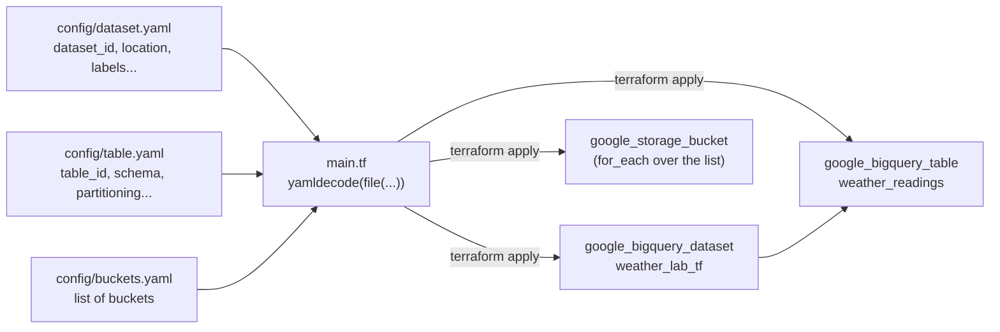

# Lab: Provisioning BigQuery with Terraform + YAML

**Infrastructure as Code — Lesson 4**

## Objective

In Lesson 3 you loaded data into BigQuery with a Python script that created
the dataset and table for you, implicitly, as a side effect of running the
ETL pipeline. That's fine for a script, but it means the *definition* of
your data warehouse lives buried inside application code.

In this lab you'll provision the same kind of resources — a BigQuery
**dataset** and a **table** inside it — declaratively, with **Terraform**.
And instead of hardcoding the dataset name or the table's columns in `.tf`
files, you'll describe them in plain **YAML config files** that Terraform
reads. Change the YAML, re-apply, and your infrastructure follows — no HCL
edits required for day-to-day changes.

This is the core idea behind almost every real infrastructure repo: HCL
defines *how* a resource is built, config files (YAML, JSON, tfvars) define
*what* gets built.

## Why YAML-driven Terraform?

Terraform's HCL is good at describing a *shape* (a dataset resource, a
table resource, a partitioning block) but it's a clunky place to store data
that changes often — column lists, labels, descriptions. Splitting the two
means:

- a data engineer who doesn't know Terraform can still add a column, by
  editing a YAML file they can read at a glance,
- the same `main.tf` can provision a completely different table just by
  swapping the YAML file it points to,
- diffs in pull requests become readable: `git diff config/table.yaml`
  shows exactly which column changed, not a wall of HCL.

## Architecture



## Prerequisites

- A GCP project with billing enabled and the BigQuery API available.
- [Terraform](https://developer.hashicorp.com/terraform/install) installed
  (this lab was tested with Terraform >= 1.5, provider `hashicorp/google`
  ~> 5.0).
- The `gcloud` CLI, authenticated for Application Default Credentials:
  ```bash
  gcloud auth application-default login
  ```
- Basic YAML familiarity (you don't need to know HCL well — that's the
  point of this lab).

## Project layout

```
lab_dataengineering_deep_dive_lesson_4/
├── README.md
├── versions.tf                 <- Terraform + provider version pins
├── variables.tf                <- project_id, region
├── main.tf                     <- reads the YAML, declares the 2 resources
├── outputs.tf                  <- prints the created dataset/table IDs
├── terraform.tfvars.example
├── config/
│   ├── dataset.yaml             <- everything about the dataset
│   ├── table.yaml                <- everything about the table (incl. schema)
│   └── buckets.yaml               <- list of GCS buckets to provision
└── exercises/
    └── exercises.md
```

## How it fits together

`config/dataset.yaml`:
```yaml
dataset_id: weather_lab_tf
friendly_name: "Weather Lab (Terraform)"
location: EU
labels:
  env: lab
```

`config/table.yaml` — schema is just a YAML list of fields:
```yaml
table_id: weather_readings
partitioning:
  type: DAY
  field: ingestion_timestamp
schema:
  - name: city
    type: STRING
    mode: REQUIRED
  - name: temperature_c
    type: FLOAT64
    mode: NULLABLE
  # ...
```

`main.tf` loads all three files once with `yamldecode(file(...))`, then uses
the result directly as resource arguments. The table's `schema` argument,
which BigQuery expects as a JSON string, is produced with a single
`jsonencode(local.table_config.schema)` — the YAML list becomes the JSON
BigQuery wants, with no manual translation.

`config/buckets.yaml` is a *list*, not a single object, so it's turned into
a map keyed by `name` (`{ for b in ... : b.name => b }`) and provisioned
with `for_each` — add a second entry to the YAML list and `terraform apply`
creates a second bucket, no HCL changes needed. Bucket names must be
globally unique across all of GCS, so `main.tf` automatically prefixes
each `name` with your `project_id` (`"${var.project_id}-${each.value.name}"`)
— the YAML only needs the short, readable suffix.

## Step-by-step instructions

### 1. Configure your project

```bash
cd lab_dataengineering_deep_dive_lesson_4
cp terraform.tfvars.example terraform.tfvars
```

Edit `terraform.tfvars` and set your real `project_id`.

### 2. Initialize Terraform

```bash
terraform init
```

This downloads the Google provider and creates `.terraform.lock.hcl`.

### 3. Preview the plan

```bash
terraform plan
```

Read the output carefully: Terraform shows you it's about to create one
`google_bigquery_dataset` and one `google_bigquery_table`, with the exact
schema from `config/table.yaml` spelled out.

### 4. Apply

```bash
terraform apply
```

Type `yes` when prompted. Terraform will print the dataset ID and the
fully-qualified table ID as outputs.

### 5. Verify in BigQuery and Cloud Storage

Open the BigQuery console, find the `weather_lab_tf` dataset, and confirm
`weather_readings` exists with the columns and partitioning you described
in YAML. Then open Cloud Storage and confirm the bucket from
`config/buckets.yaml` exists (`terraform output bucket_names` prints its
full, prefixed name).

If you're doing this alongside `lesson_5_pipeline`, this is the same
bucket that lab's Eventarc trigger watches — provisioning it here with
Terraform instead of by hand in the console is the natural next step once
you've clicked through creating it manually once.

### 6. Change the YAML, not the HCL

Try editing `config/table.yaml` — for instance, add a `description` to a
field that doesn't have one yet — then run `terraform plan` again. You'll
see an in-place update proposed, with zero changes to any `.tf` file. This
is the whole point of the lab.

### 7. Clean up

```bash
terraform destroy
```

`delete_contents_on_destroy` and `deletion_protection = false` are set in
`main.tf` specifically so this works cleanly in a classroom setting — call
out to students that these would be dangerous defaults in a real
production configuration (see Exercise 3).

## Next steps

Head to [`exercises/exercises.md`](exercises/exercises.md): adding columns,
breaking a schema change on purpose to see what Terraform does, adding
clustering, provisioning a second table with `for_each`, and pointing the
Lesson 3 ETL pipeline at the table you provisioned here.
